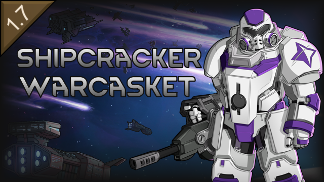

# Shipcracker Warcasket

> A RimWorld mod adding a late-game warcasket set for Vanilla Factions Expanded - Pirates

## About

Vanilla Factions Expanded - Pirates lets you weld a pawn into a warcasket: a steel shell,
customized part by part at the foundry, with a range of sets that carries a colony from the
industrial era into the late game. This mod adds one more set to that range: the Shipcracker, a
boarding suit whose armor carries drop thrusters that throw the wearer over walls and land hard
enough to punch through them. In orbit the same thrusters become a long-range burn straight into
an enemy hull.

Odyssey is optional. Without it, the Shipcracker is a planet-side breaching suit.

## Features

### The Shipcracker Set

Armor, shoulder pads and helmet, welded on at VFE Pirates' warcasket foundry and unlocked by its
spacer warcaskets research. Close-combat plating on all three pieces, hitting a balance point
between VFE Pirates' Siegebreaker, Brute and Guardian sets.

- **Armor**: the drop engine. Carries the Breach Jump and its chemfuel tank, plus a shield bubble
  against incoming fire
- **Shoulder pads**: the breaching arms. Landings hit structures 50% harder, enough for plasteel
  and uranium walls, and the wearer hits and dodges more often in melee
- **Helmet**: the sealed helm. A built-in respirator keeps breathing at full capacity, plus a
  small aiming speed bonus
- **With Odyssey** the full set is fully vacuum rated, and the thrusters cost gravlite panels
- **Built on VFE Pirates** rather than beside it: the foundry, entombing, customization and
  removal surgery all apply unchanged, and the pieces mix and match with VFE Pirates' own sets

### Breach Jump

- Jump up to 20 cells, no clear path needed, burning 20 chemfuel from a 100-unit tank
- The landing blast knocks a door-sized hole in the wall beside it and wounds anyone caught in
  it, allies included
- Takeoff and landing crash through the ceiling unless the jump stays inside one room; mountain
  roofs are too thick to break
- The blast area is previewed at the cursor while targeting

### Breach Burn

In space the jump becomes the breach burn: no range limit and a much faster flight, but the way
must be open. Every reachable cell in view is outlined while targeting, and breaking through a
gravship's roof vents the room behind it.

## Requirements

- **RimWorld 1.6** or **1.7**
- **Vanilla Factions Expanded - Pirates** (required), which itself requires
  **Vanilla Expanded Framework**
- **Harmony** (auto-download from Steam Workshop if you don't have it)
- **Odyssey DLC** is optional; without it there is no space to fly the breach burn in, and the
  gravlite panel cost drops out

## Installation

### Steam Workshop (Recommended)

Subscribe on the [Steam Workshop](https://steamcommunity.com/sharedfiles/filedetails/?id=3814428597) and it will auto-download.

### Manual Installation

1. Download the latest release from the [Releases](https://github.com/sam-hunt/ShipcrackerWarcasket/releases) page
2. Extract the `ShipcrackerWarcasket` folder to your RimWorld `Mods` directory:
   - **Windows**: `C:\Program Files (x86)\Steam\steamapps\common\RimWorld\Mods\`
   - **Mac**: `~/Library/Application Support/Steam/steamapps/common/RimWorld/RimWorldMac.app/Mods/`
   - **Linux**: `~/.steam/steam/steamapps/common/RimWorld/Mods/`
3. Enable the mod in RimWorld's mod menu, after Vanilla Factions Expanded - Pirates
4. Restart RimWorld

## Compatibility

- **Safe to add** to existing saves.
- **Not safe to remove** from saves while a pawn is welded into the set.
- **Save Our Ship 2 / Universum**: EVA rated under exactly the same rules as VFE Pirates' own sets.
- **Vanilla Gravship Expanded**: follows its vacuum rules for warcaskets, and the helmet carries its
  own oxygen supply (refilled with oxygen canisters) so the set still needs no oxygen pack. The
  wearer can cross open space terrain at about half walking speed, and the tank takes astrofuel
  instead of chemfuel (10 per jump, so 10 jumps per tank) with a purple exhaust to match.
- Not tested with Combat Extended.

## Contributing

Bug reports and feature requests welcome on [GitHub Issues](https://github.com/sam-hunt/ShipcrackerWarcasket/issues).
Please attach any relevant logs/stack traces/mod lists etc.

Translations are welcome - see [CONTRIBUTING.md](CONTRIBUTING.md).
For development setup, see [CLAUDE.md](CLAUDE.md).

## Credits

**Author**: Sam Hunt ([@sam-hunt](https://github.com/sam-hunt))

**Built With**:

- [Harmony](https://github.com/pardeike/Harmony) by Andreas Pardeike - Runtime patching library
- RimWorld modding API, community examples

**Special Thanks**:

- The [Vanilla Expanded team](https://steamcommunity.com/sharedfiles/filedetails/?id=2723801948) for Vanilla Factions Expanded - Pirates
- [Ludeon Studios](https://ludeon.com) for RimWorld and modding API
- [The RimWorld modding community](https://steamcommunity.com/app/294100/workshop/) for inspiration
